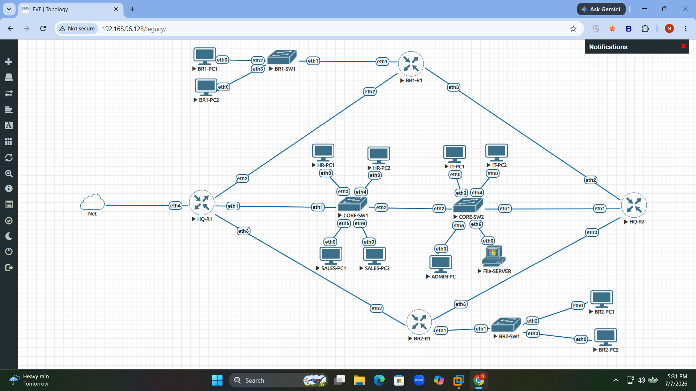

# Enterprise Multi-Branch Network Lab

A three-site enterprise network designed for **MikroTik RouterOS v7** in **EVE-NG Community Edition**. It combines HQ departmental VLANs, two branches, OSPF multi-area routing, redundant HQ gateways, baseline firewall policy, DHCP, and planned centralized logging.



> **Current state (24 October 2026):** The exported lab topology and RouterOS configuration set have been reconciled in source control. Static consistency checks can run without EVE-NG. **Live RouterOS import, connectivity, security and failure-recovery tests have not been rerun.** Screenshots in `images/` are retained as earlier lab records; they do not prove this revised configuration.

## Network at a glance

| Site | Nodes | Networks |
| --- | --- | --- |
| Headquarters | HQ-R1, HQ-R2, CORE-SW1, CORE-SW2 | VLAN 10 HR, 20 Sales, 30 IT, 40 Servers, 50 Management |
| Branch 1 | BR1-R1, BR1-SW1 | VLAN 110 users |
| Branch 2 | BR2-R1, BR2-SW1 | VLAN 210 users |
| WAN | Four point-to-point links | 10.0.1.0/30 through 10.0.4.0/30 |

Printer VLANs 60, 120 and 220 are in the address plan, but are not implemented in the current lab.

The four WAN interfaces at each branch and HQ use OSPF Area 0. Each branch advertises its local network through a passive interface in Area 10 or 20. HQ LAN interfaces are advertised passively from the backbone. HQ-R1 and HQ-R2 provide gateway VIPs ending in `.254` for VLANs 10–50.

## Files

- [EVE-NG topology export](lab/Enterprise_Multi_Branch_Network.unl)
- [Device configuration scripts](configs/README.md)
- [Rebuild and acceptance checklist](docs/REBUILD-AND-ACCEPTANCE.md)
- [Design decisions and limitations](docs/NETWORK-DECISIONS.md)
- [Static audit checker](tools/lint_lab.py)
- [Linux logging and time-service reference](services/README.md)
- [Testing log / results template](docs/Testing-and-Validation.md)
- [Historical phase walkthroughs](docs/Phase-00-Project-Overview.md)
- [Troubleshooting notes](docs/Troubleshooting.md)

## Rebuild sequence

1. Use an EVE-NG installation with the CHR 7.21.4 QEMU image.
2. Import the `.unl` topology. Verify that both HQ routers connect `ether4` to the EVE-NG management cloud `pnet0`. The lab assumes this segment provides DHCP and outside access.
3. Apply the eight RouterOS exports to clean devices, starting with the switches. See [import order](configs/README.md).
4. Set up an actual Linux service VM in VLAN 40 at `172.16.40.201`. The VPCS node labeled `SYSLOG-SERVER` in the exported lab is a **connectivity placeholder**, not a running collector.
5. Run `python3 tools/lint_lab.py` for local structure checks, then work through the [live test plan](docs/REBUILD-AND-ACCEPTANCE.md).
6. Preserve device exports, command output and timestamps from successful testing.

## What the configuration does and does not claim

- **VLAN / IP plan:** Port assignments were aligned with the actual EVE-NG cable map. Real forwarding still needs a live check.
- **OSPF:** Area IDs now match on each WAN segment; convergence and route selection still require runtime verification.
- **VRRP:** Uses non-owner priorities 150/100 and virtual `/32` addresses. Gateway role transition has not yet been measured on the revised lab.
- **Internet access:** Both HQ routers have DHCP WAN clients and outbound NAT. After failure, new sessions may work through a different public IP; existing sessions can drop.
- **DHCP:** Split address pools reduce one-server dependency but do not synchronize leases.
- **Security:** Specific cross-zone denials and explicit router input drop rules are present. This is **not** zero-trust: a business-approved application flow matrix, OSPF authentication, IPv6 policy and penetration validation remain open.
- **Syslog / NTP:** Router configuration points to `172.16.40.201`; actual server processes are not bundled as a running EVE node.
- **Performance:** No verified throughput, packet-loss, convergence-time or SLA result is claimed for this revision.

The long-form phase guides document design and learning steps. Some pre-revision command/output examples differ from the configuration set. When they conflict, use `configs/*.rsc` and the live acceptance checklist.

## Static checks

```sh
python3 tools/lint_lab.py
```

The standard-library checker validates VLAN access ports against the `.unl` cables, OSPF transit areas, VRRP parameters, backup egress configuration, command paths, and README links. GitHub Actions runs the same check on proposed changes. This is **not** a RouterOS syntax test or network emulator.

## Next validation milestone

A live EVE-NG environment is necessary to complete end-to-end proof. The checkboxes and exact router commands are in [the acceptance checklist](docs/REBUILD-AND-ACCEPTANCE.md). Until that work is completed, the project is described as an **enterprise network design and reproducible emulation lab**, not a deployed production network.

## License

[MIT](LICENSE). CHR images and EVE-NG software are not distributed in this repository and retain their own licensing conditions.
