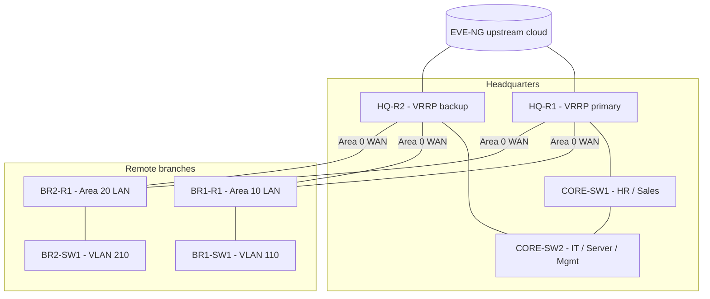

<div align="center">

# 🌐 Enterprise Multi-Branch Network with High Availability & Multi-Area Routing

A hands-on enterprise networking project **built and tested in EVE-NG** using **MikroTik RouterOS (CHR) v7**. It covers VLAN segmentation, multi-area OSPF, DHCP, Internet/NAT, firewall policies, VRRP gateway failover, secure administration and centralized logging/time synchronization. The original implementation and test screenshots are preserved in this repository.


</div>

> **Project history:** The original network was implemented and tested by Neloy Pramanik Supto in EVE-NG. The [screenshot evidence register](docs/EVE-NG-TEST-EVIDENCE.md) indexes 79 project images and explains the recorded outcomes. In October 2026, the topology and RouterOS configuration scripts were revised for consistency; that **newer configuration has passed static CI checks but has not been rerun in EVE-NG**. These are two different validation states.

**Quick access:** [EVE-NG lab file](lab/Enterprise_Multi_Branch_Network.unl) · [RouterOS scripts](configs/README.md) · [Detailed phase guides](docs/Phase-00-Project-Overview.md) · [Historical testing report](docs/Testing-and-Validation.md) · [Revised-build test checklist](docs/REBUILD-AND-ACCEPTANCE.md)

---

## 📌 Detailed Project Scenario & Executive Narrative

In a modern high-scale corporate environment, network infrastructure must satisfy three critical engineering goals: **Resilience (High Availability)**, **Segmentation and Access Control**, and **Scalable Management**. 

This project simulates a corporate enterprise consisting of a primary **Corporate Headquarters (HQ) Campus Hub** interconnected across redundant point-to-point leased WAN serial meshes to two remote **Distributed Regional Branch Offices**. The implementation brings switching, routing, security and operations together in a controlled emulated environment. 

### Why This Architecture Matters:
* **Resilience Against Outages:** The corporate core uses physical gateway pairs grouped into active/standby clusters. If the master interface drops, the backup can take over the shared virtual gateway during the documented failover test (the screenshots do not give a reliable packet-loss or convergence-time measurement).
* **Dynamic Mesh Scaling:** Remote sites run isolated dynamic stubs. Adding a new regional branch office requires zero static routing adjustments at the central hub.
* **Network Segmentation & Hardening:** Lateral movement between administrative sections and endpoint spaces is blocked directly at the gateway layer using stateful access rules.

---

## 🏗️ Deep-Dive Structural Architecture Breakdown

The entire enterprise address allocation scheme uses a structured, non-overlapping **RFC 1918 Private Address Blueprint**, dividing the subnets cleanly to simplify administration and path summaries.


### Original-style topology sketch

The earlier README used a console-style topology drawing. This updated sketch keeps that format but reflects the actual 21-node export and the corrected WAN/port layout:

```text
                            [ EVE-NG upstream / pnet0 cloud ]
                                   |                  |
                               HQ-R1 ether4       HQ-R2 ether4
                                   |                  |
                              [ HQ-R1 ]          [ HQ-R2 ]
                          VRRP primary (150)   VRRP backup (100)
                               | ether1            | ether1
                               v                   v
                           [ CORE-SW1 ] ===== [ CORE-SW2 ]
                           HR / Sales     trunk   IT / Server / Mgmt
                           VLAN 10,20            VLAN 30,40,50
                               |                      |
                              / \                    / \
               Area 0 WAN #1/#2 \                  / Area 0 WAN #3/#4
                             [ BR1-R1 ]      [ BR2-R1 ]
                              | ether1        | ether1
                           [ BR1-SW1 ]     [ BR2-SW1 ]
                              | VLAN110       | VLAN210
                          Branch 1 PCs     Branch 2 PCs
```

All four HQ-to-branch WAN links run OSPF Area 0 in the revised configuration. Branch user networks belong to passive Area 10 and Area 20, respectively. The `.unl` file is authoritative for physical cabling; this sketch is a conceptual view. Printer VLANs 60, 120 and 220 remain planned only.


> This is a logical overview. The [EVE-NG `.unl` file](lab/Enterprise_Multi_Branch_Network.unl) is authoritative for port-level cabling. VLANs 60, 120 and 220 are documented as planned printer networks, **not configured endpoints** in the exported lab.

### 🏢 1. Corporate Headquarters Campus Domain
The central hub campus terminates multiple internal organizational subnets using an optimized **Router-on-a-Stick (RoaS)** virtual sub-interface model bound to core switching trunks.
* **VLAN 10 (Human Resources):** `172.16.10.0/24` — Encloses local HR workstations and employee records.
* **VLAN 20 (Sales Operations):** `172.16.20.0/24` — Contains transaction processing client systems.
* **VLAN 30 (IT Administration):** `172.16.30.0/24` — Secure subnet for network administrators and engineering management hosts.
* **VLAN 40 (Server Core Farm):** `172.16.40.0/24` — Highly secured data center segment housing central business assets:
  * *Production File Database:* `172.16.40.20`
  * *Centralized Log Aggregator & NTP Time Authority:* `172.16.40.201`
* **VLAN 50 (Management):** `172.16.50.0/24` — Provides management IP connectivity within the emulated HQ LAN; it is not a physically isolated out-of-band network.
* **VLAN 60 (Corporate Printers — planned):** `172.16.60.0/24` — Address plan only; no printer nodes in the exported lab.

### 🏬 2. Distributed Branch Offices Domain
Remote sites handle local traffic using localized switching and independent routing nodes to ensure site survivability.
* **Branch Office 1 (OSPF Area 10 - Stub Boundary Region):**
  * Local Edge Gateway Node: `BR1-R1` | Local Distribution Switch: `BR1-SW1`
  * *VLAN 110 (Branch Users):* `172.16.110.0/24` (Dynamic Pool: `.100` to `.200`)
  * *VLAN 120 (Branch Printers — planned):* `172.16.120.0/24`
* **Branch Office 2 (OSPF Area 20 - Stub Boundary Region):**
  * Local Edge Gateway Node: `BR2-R1` | Local Distribution Switch: `BR2-SW1`
  * *VLAN 210 (Branch Users):* `172.16.210.0/24` (Dynamic Pool: `.100` to `.200`)
  * *VLAN 220 (Branch Printers — planned):* `172.16.220.0/24`

---

## 🔁 End-to-End Enterprise Packet Flow Logic

To verify the cross-site forwarding engine, outbound traffic traces from remote endpoints follow a structured path across Layer 2 and Layer 3 boundaries:

1. **Local Ingress Processing:** A workstation inside Branch-1 (`VLAN 110`) initiates an outbound request. The local switch assigns the appropriate VLAN tag to the untagged frames based on its PVID configuration.
2. **Layer 3 Regional Escalation:** The tagged packet transits the local access trunk up to `BR1-R1`, which strips the 802.1Q header and examines the destination field.
3. **Dynamic OSPF Transit:** Matching the destination to its link-state routing table, `BR1-R1` routes the packet over the point-to-point WAN link (`10.0.1.0/30`) toward the Headquarters backbone area core.
4. **Active VRRP Core Redirection:** The packet reaches the HQ fabric and is routed at the selected HQ router before entering the destination VLAN (HQ hosts separately use the VRRP gateway **`172.16.x.254`**). The active Master node (`HQ-R1`) intercepts the packet and processes it through its stateful firewall engine.
5. **Stateful Perimeter Inspection & NAT Translation:** The forwarding rules confirm the packet is legitimate. As it exits toward the Internet cloud via the outside WAN interface (`ether4`), the NAT engine records the session and masquerades the private source address behind the upstream-assigned address.
6. **Symmetric Return Delivery:** Inbound internet reply packets are matched against the router's active session state tables, allowing the gateway to translate the destination headers back to the original requesting host.

---

## 📑 Phase-by-Phase Technical Configuration Manuals Index

The entire infrastructure lifecycle is broken down into structured technical modules inside the **[docs/](./docs/)** folder, with design explanations, RouterOS examples, troubleshooting notes and screenshot evidence. For the latest importable scripts, use the [revised configuration directory](configs/README.md):

### ⚙️ Module I: Foundation Infrastructure & Initialization
* **[Phase 00 – Hypervisor server & Environment Preparation](./docs/Phase-00-Environment-Setup.md)**
  * *Focus:* Nested virtualization settings, EVE-NG server deployment parameters, and RouterOS QEMU image integration templates.
* **[Phase 01 – Enterprise Network Design & IP Address Planning](./docs/Phase-01-Network-Planning-and-IP-Addressing.md)**
  * *Focus:* Non-overlapping RFC 1918 allocation grids, subnet design math, and multi-site interface mapping models.
* **[Phase 02 – Virtual Topology Assembly & Interface Cabling](./docs/Phase-02-Infrastructure-Deployment.md)**
  * *Focus:* Port-to-port physical mapping matrix verification, link duplex configuration, and host naming standards.

### ⚙️ Module II: Layer 2 Segmentation & Layer 3 Routing Planes
* **[Phase 03 – IEEE 802.1Q Bridge VLAN Filtering Core Configuration](./docs/Phase-03-VLAN-Configuration.md)**
  * *Focus:* Setting up hardware-accelerated bridge filter switches, configuring PVID settings for access ports, and tagging multi-VLAN trunk links.
* **[Phase 04 – Router-on-a-Stick Layer 3 Inter-VLAN Gateway Termination](./docs/Phase-04-Inter-VLAN-Routing.md)**
  * *Focus:* Provisioning virtual sub-interfaces on top of physical trunks and setting up line-rate inter-department routing.
* **[Phase 05 – Centralized DHCP Server Scopes & Remote Relay Automation](./docs/Phase-05-DHCP.md)**
  * *Focus:* Defining allocation pool boundaries, setting up automated DORA bindings, and separating client lease scopes.
* **[Phase 06 – OSPFv2 Hierarchical Multi-Area Protocol Path Engine](./docs/Phase-06-OSPF-Multi-Area-Routing.md)**
  * *Focus:* Configuring RouterOS v7 OSPF instances, routing templates, and establishing neighbor relationships across Areas 0, 10, and 20.

### ⚙️ Module III: Security Hardening & High-Availability Clusters
* **[Phase 07 – Centralized Internet Egress WAN Routing & Source NAT](./docs/Phase-07-NAT-and-Internet-Connectivity.md)**
  * *Focus:* Managing outside ISP interface uplinks, deploying masquerade translation rules, and injecting dynamic default routes (`0.0.0.0/0`).
* **[Phase 08 – Stateful Firewall Filter Chains & Department ACLs](./docs/Phase-08-ACL-and-Firewall.md)**
  * *Focus:* Building input/forward filter pipelines, preventing lateral movement between restricted subnets, and optimizing connection tracking.
* **[Phase 09 – Dual-Homed VRRP Redundant Gateway High Availability](./docs/Phase-09-VRRP-High-Availability.md)**
  * *Focus:* Virtualizing corporate default gateway points (`.254`), tuning hello keepalive intervals, and recording gateway role changes during failover.
* **[Phase 10 – Cryptographic SSHv2 Control Plane Remote Hardening](./docs/Phase-10-SSH.md)**
  * *Focus:* Disabling unencrypted legacy management protocols (Telnet, HTTP, API), enforcing strong cryptographic ciphers, and creating custom admin profiles.

### ⚙️ Module IV: Telemetry Operations & Final System Validation
* **[Phase 11 – Centralized Event Telemetry Aggregation via Remote Syslog](./docs/Phase-11-Syslog.md)**
  * *Focus:* Dynamic logging target aggregation and streaming runtime kernel event messages to data center host `172.16.40.201`.
* **[Phase 12 – Authoritative NTP System Time Synchronization Grid](./docs/Phase-12-NTP.md)**
  * *Focus:* Deploying modern RouterOS v7 unicast NTP client servers to correct clock drift and maintain accurate log timestamps.
* **[Phase 13 – Systematic Production Testing & Final Project Validation](./docs/Phase-13-Conclusion.md)**
  * *Focus:* Comprehensive cross-site validation sweeps, dynamic convergence audits, and structural readiness reviews.
* **[Master Operations Guide – Comprehensive Network Troubleshooting Manual](./docs/Troubleshooting.md)**
  * *Focus:* A comprehensive diagnostic reference guide listing common system errors, root-cause analyses, and mitigation scripts.

---

## 📊 Infrastructure Validation Status Summary Matrix

The original EVE-NG project was tested by the author. These records summarize **what the screenshots actually show** and which updated-build tests remain outstanding; this is not a measured production SLA.

| Target Verification Control Item | Mapped Infrastructure Component | Original EVE-NG Test Evidence | October 2026 Updated Configuration |
| :--- | :--- | :--- | :--- |
| **Layer 2 Segmentation** | Bridge VLAN filtering | ✅ [VLAN reachability and VPCS responses](images/testing/vlan-verification.png) | Port map realigned to `.unl`; runtime retest needed |
| **Inter-VLAN Forwarding** | Router-on-a-stick | ✅ [Successful cross-VLAN pings](images/phase-04/inter-vlan-connectivity-test.png) | `.254` gateway behavior needs a new test |
| **Dynamic Addressing** | DHCP pools and clients | ✅ [DORA and bound DHCP leases](images/phase-05/dhcp-lease-verification.png) | Split HQ scopes and virtual gateway need retest |
| **Dynamic Path Propagation** | Multi-area OSPF | ✅ [Full neighbor and learned routes](images/phase-06/ospf-neighbor-verification.png) | Four corrected Area 0 WAN links need retest |
| **Border Egress Translation** | Source NAT / Internet access | ✅ [Internet ping](images/phase-07/internet-connectivity-test.png), [masquerade rule](images/phase-07/source-nat-configuration.png) | HQ-R2 egress and failover NAT need retest |
| **Control Plane Security** | Stateful firewall / ACLs | ✅ [HR→IT denied traffic](images/testing/firewall-test.png), [drop counters](images/phase-08/firewall-rule-validation.png) | Full deny/permit policy on both gateways needs retest |
| **Gateway Cluster Redundancy** | VRRP Master / Backup | ✅ [Takeover](images/phase-09/vrrp-failover-test.png) and [recovery](images/phase-09/vrrp-recovery-verification.png) captured | New VRRP settings and exact packet-loss timing need retest |
| **Management Hardening** | SSH | ✅ [Administrative SSH session](images/phase-10/ssh-login-verification.png) | Current allowlist and denied-source test pending |
| **Telemetry Aggregation** | Remote Syslog | ✅ [Linux collector and UDP capture](images/phase-11/syslog-validation.png) | Informational logging restored in source; service VM/test still needed |
| **Time Synchronization** | NTP client / server | ✅ [RouterOS synchronized status](images/phase-12/time-synchronization-verification.png) | Rebuild with Linux service VM; verify actual clock offsets |

See the [annotated register of 79 screenshots](docs/EVE-NG-TEST-EVIDENCE.md) for limitations and version differences, and the [rebuild checklist](docs/REBUILD-AND-ACCEPTANCE.md) for live retesting.

---

## 🛠️ Demonstrated Core Infrastructure Engineering Skills

Building and managing this enterprise network lifecycle demonstrates key proficiencies across several critical infrastructure engineering tracks:
* **Enterprise Architecture Lab:** Translating real-world corporate availability goals into resilient multi-site routing and switching designs.
* **MikroTik RouterOS v7 Expertise:** Deploying advanced platform-specific templates, routing instances, and stateful bridge filters via command-line interface utilities.
* **High Availability Cluster Design:** Virtualizing layer-3 termination points using stateful protocol engines to shield end users from hardware faults.
* **Stateful Firewall Structural Architecture:** Designing secure, multi-zone forward and input filter chains to stop lateral network threats.
* **Telemetry System Operations:** Centralizing log management backplanes and network timing grids to improve audit visibility and speed up incident tracking.

---

## 👨‍💻 Author Profile & Engineering Portfolio

**Neloy Pramanik Supto**  
*Network Security & Systems Infrastructure Engineer*

* **GitHub Main Portfolio:** [https://github.com/Neloy4321](https://github.com/Neloy4321)
* **Enterprise Project Repository:** [Enterprise-Multi-Branch-Network-with-High-Availability](https://github.com/Neloy4321/Enterprise-Multi-Branch-Network-with-High-Availability)

---


## 🔎 Source, Versions and Reproducibility

- The [EVE-NG topology export](lab/Enterprise_Multi_Branch_Network.unl) contains 21 nodes (eight CHR and thirteen VPCS hosts).
- [Current RouterOS scripts](configs/README.md) have been reconciled with the exported cable map. The [rebuild instructions](docs/REBUILD-AND-ACCEPTANCE.md) document the live checks remaining for these edited files.
- Original screenshots were produced during earlier lab sessions and include gateway addresses ending `.1`, VRRP priority 255 and a RouterOS 7.12 SSH screenshot. The newer scripts use VIPs ending `.254`, priorities 150/100 and target a 7.21.4 CHR image.
- The historical Syslog/NTP Linux host appears in [service screenshots](docs/EVE-NG-TEST-EVIDENCE.md); the present export contains a VPCS placeholder rather than a bootable Linux collector. See [service setup](services/README.md).
- The [static CI check](tools/lint_lab.py) validates source consistency and links. It is not a substitute for EVE-NG packet-flow and failover testing.

---

## 📜 Project License Boundary
This enterprise deployment documentation, master architectural file set, and hardware configuration script index are open-source assets published under the terms of the **MIT License**. Review the `LICENSE` text file for complete operational compliance details.
