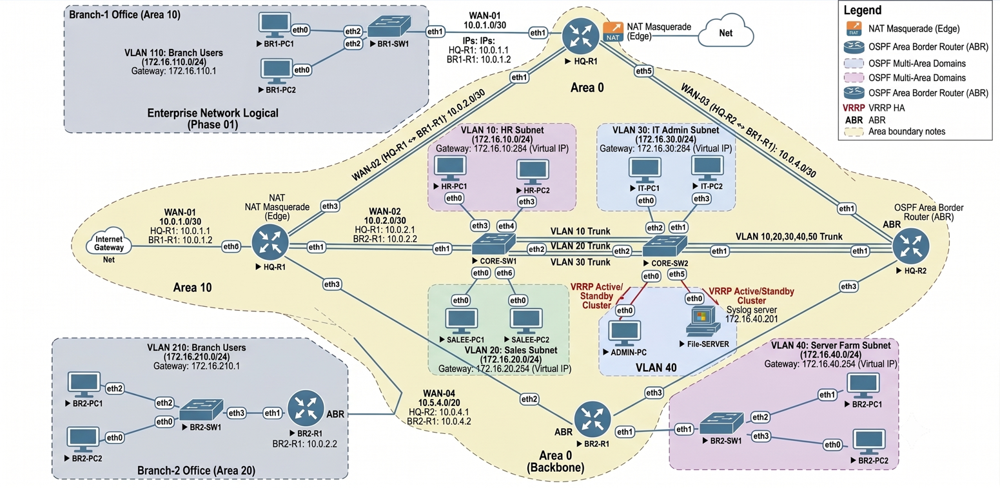

> **October 2026 revision note:** This page is retained from the original lab build. Its screenshots and sample command output are historical; they are not the acceptance result for the revised `configs/*.rsc` files. Use [the current test checklist](REBUILD-AND-ACCEPTANCE.md) and [design decisions](NETWORK-DECISIONS.md) for source-level expectations.

# 📂 Phase 01 – Enterprise Network Planning & IP Addressing

## 📌 Objective
The primary objective of this phase was to construct a scalable, deterministic, and highly available enterprise architectural design blueprint before initiating any hardware configurations. This planning phase establishes a rigorous engineering specification covering physical topology interconnections, logical traffic paths, standard 802.1Q VLAN structures, full interface mapping matrices, a point-to-point WAN addressing layout, and multi-area routing domain scopes.

---

# 🏢 Project Blueprint Overview

This architecture simulates a high-availability corporate infrastructure spanning a centralized **Headquarters (HQ)** and two geographically isolated **Remote Branch Offices** linked via point-to-point transit WAN layers. The planning matrix aligns directly with modern enterprise network design rules: maximizing infrastructure reliability, implementing zero-trust zone segmentation, and securing internal management perimeters.

### Core Enterprise Architecture Blocks:
* **Resilient Edge Hub:** Dual-homed core architecture using active/backup default gateway redundancy.
* **Hierarchical Core Switching:** Distributed VLAN trunk fabrics utilizing bridge filtering policies.
* **Dynamic Multi-Area Routing Backbone:** Automatic path calculation and border route filtering layout.
* **Centralized Application Zones:** Isolated secure server subnets hosting monitoring tools and database assets.

---

# 📋 Engineering Requirements Matrix

| Design Requirement | Technical Strategy | Engineering Implementation Role |
| :--- | :--- | :--- |
| **Multi-Site Connectivity** | Redundant Transit WAN Networks | Interconnects the corporate hub with distributed branches over active/standby links. |
| **Dynamic Routing Fabric** | OSPF Multi-Area Protocols | Establishes Area 0 (Backbone), Area 10, and Area 20 dynamic route updates. |
| **Zoned Logic Isolation** | IEEE 802.1Q VLAN Segmentation | Allocates strict `/24` broadcast boundaries per corporate department. |
| **Automated Addressing** | Centralized DHCP Server & Relay | Provisions IP parameters automatically using the VRRP virtual gateway metric. |
| **Edge Border Translation** | Stateful Source NAT Masquerade | Consolidates internal corporate transit out of a single public edge port. |
| **Security Governance** | RouterOS Firewall Access Chains | Enforces stateful filter blocks across cross-zone inter-vlan traffic. |
| **Gateway Fault Tolerance** | VRRP Active/Standby Clusters | Shares a virtual gateway IP to handle instantaneous core link failures. |
| **Administrative Hardening** | Cryptographic SSH Tunneling | Disables vulnerable protocols (Telnet/HTTP) and restricts access to trusted zones. |

---

# 🗺️ Enterprise Network Architecture & Design

The enterprise framework is built around a classic tree-hierarchical structure. The corporate Headquarters functions as the root routing transit hub, the primary boundary authority for dynamic routing, and the central provider of internal resources. Each remote branch operates its own local boundary gateway and downstream access switch layer, functioning autonomously for internal tasks while dynamically tracking remote paths via the WAN link meshes.

### 📑 Documentation Evidence

#### Figure 1. Enterprise Network Logical Blueprint

*High-level conceptual blueprint defining the corporate boundaries, department zones, and WAN interconnections.*

---

#### Figure 2. EVE-NG Production Topology Layout

*The active simulated hardware node deployment grid executed inside the EVE-NG canvas workspace[cite: 1, 2].*

---

# 💾 Physical Inventory Configuration

| Device Hostname | Emulated Hardware Platform | Operating System Engine | Primary Network Deployment Role |
| :--- | :--- | :--- | :--- |
| **HQ-R1** | MikroTik Cloud Hosted Router | RouterOS v7.21.4 | VRRP Master Gateway / Border NAT / OSPF Backbone Node |
| **HQ-R2** | MikroTik Cloud Hosted Router | RouterOS v7.21.4 | VRRP Backup Gateway / Redundant OSPF Core Transit Node |
| **CORE-SW1** | MikroTik Cloud Hosted Router | RouterOS v7.21.4 | HQ L2 Core Switch 1 (HR, Sales, IT Access Processing)[cite: 1, 2] |
| **CORE-SW2** | MikroTik Cloud Hosted Router | RouterOS v7.21.4 | HQ L2 Core Switch 2 (Server Farms & Management Anchors)[cite: 1, 2] |
| **BR1-R1** | MikroTik Cloud Hosted Router | RouterOS v7.21.4 | Branch-1 Gateway / OSPF Area 10 Border Router |
| **BR1-SW1** | MikroTik Cloud Hosted Router | RouterOS v7.21.4 | Branch-1 Local L2 Access Distribution Switch |
| **BR2-R1** | MikroTik Cloud Hosted Router | RouterOS v7.21.4 | Branch-2 Gateway / OSPF Area 20 Border Router |
| **BR2-SW1** | MikroTik Cloud Hosted Router | RouterOS v7.21.4 | Branch-2 Local L2 Access Distribution Switch |
| **Endhosts** | Virtual PC Simulator (VPCS) | EVE-NG Native | Simulated Client Endpoints (`HR-PC`, `SALES-PC`, `IT-PC`) |

---

# 🗺️ Detailed Physical & Logical Interface Map

To maintain structural symmetry across the dual-homed layout, the core links and physical ports are mapped using a strict interface blueprint:

| Source Node | Source Interface | Destination Node | Destination Interface | Operational Link Classification |
| :--- | :--- | :--- | :--- | :--- |
| **HQ-R1** | `ether1` | **CORE-SW1** | `ether1` | HQ Core Trunk Link (VLAN 10,20,30,40,50)[cite: 1, 2] |
| **HQ-R1** | `ether2` | **BR1-R1** | `ether2` | Redundant WAN Link (WAN-01 Subnet) |
| **HQ-R1** | `ether3` | **BR2-R1** | `ether2` | Redundant WAN Link (WAN-02 Subnet) |
| **HQ-R1** | `ether4` | **Cloud0** | `pnet0` | Edge WAN Gateway Internet Egress Connection[cite: 1, 2] |
| **HQ-R2** | `ether1` | **CORE-SW2** | `ether1` | Redundant HQ Core Trunk Link[cite: 1, 2] |
| **HQ-R2** | `ether2` | **BR1-R1** | `ether3` | Redundant WAN Link (WAN-03 Subnet) |
| **HQ-R2** | `ether3` | **BR2-R1** | `ether3` | Redundant WAN Link (WAN-04 Subnet) |
| **CORE-SW1**| `ether2` | **CORE-SW2** | `ether2` | Inter-Switch Core Trunk Backbone Link[cite: 1, 2] |
| **CORE-SW1**| `ether3` | **HR-PC1 / PC2**| `eth0` | Access Port Map: VLAN 10 (HR Subnet)[cite: 1, 2] |
| **CORE-SW1**| `ether4` | **SALES-PC1/PC2**| `eth0` | Access Port Map: VLAN 20 (Sales Subnet)[cite: 1, 2] |
| **CORE-SW1**| `ether5` | **IT-PC1 / PC2**| `eth0` | Access Port Map: VLAN 30 (IT Admin Subnet)[cite: 1, 2] |
| **CORE-SW2**| `ether3` | **File-SERVER** | `eth0` | Access Port Map: VLAN 40 (Production Server)[cite: 1, 2] |
| **CORE-SW2**| `ether4` | **ADMIN-PC** | `eth0` | Access Port Map: VLAN 50 (Management Subnet)[cite: 1, 2] |
| **CORE-SW2**| `ether7` | **SYSLOG-SERVER**| `eth0` | Access Port Map: VLAN 40 (Monitoring Server)[cite: 1, 2] |
| **BR1-R1** | `ether1` | **BR1-SW1** | `ether1` | Branch-1 Local Trunk Link (VLAN 110)[cite: 1, 2] |
| **BR1-SW1** | `ether2/ether3`| **BR1-PC1 / PC2**| `eth0` | Access Port Map: VLAN 110 (Branch Users)[cite: 1, 2] |
| **BR2-R1** | `ether1` | **BR2-SW1** | `ether1` | Branch-2 Local Trunk Link (VLAN 210)[cite: 1, 2] |
| **BR2-SW1** | `ether2` | **BR2-PC1 / PC2**| `eth0` | Access Port Map: VLAN 210 (Branch Users)[cite: 1, 2] |

---

# 🔢 IP Addressing Strategy & Subnet Allocation Plan

The addressing blueprint follows a strict matching system where the third octet of the IP network matches the local VLAN ID, making logic filtering and long-term troubleshooting significantly easier.

### 1. Corporate Headquarters Local Subnet Allocations
* **VLAN 10 (HR Department):** `172.16.10.0/24` ── Gateway: `172.16.10.254` *(Shared Virtual IP)*
* **VLAN 20 (Sales Operations):** `172.16.20.0/24` ── Gateway: `172.16.20.254` *(Shared Virtual IP)*
* **VLAN 30 (IT Administration):** `172.16.30.0/24` ── Gateway: `172.16.30.254` *(Shared Virtual IP)*
* **VLAN 40 (Server Core Farm):** `172.16.40.0/24` ── Gateway: `172.16.40.254` *(Shared Virtual IP)*
* **VLAN 50 (Management Infrastructure):** `172.16.50.0/24` ── Gateway: `172.16.50.254` *(Shared Virtual IP)*

### 2. Remote Branch Subnet Allocations
* **VLAN 110 (Branch-1 Local Users):** `172.16.110.0/24` ── Gateway: `172.16.110.1` *(Local Router Physical IP)*
* **VLAN 210 (Branch-2 Local Users):** `172.16.210.0/24` ── Gateway: `172.16.210.1` *(Local Router Physical IP)*

### 3. Point-to-Point WAN Transport Links Addressing Plan
To avoid wasting address space, point-to-point connections are carved cleanly out of localized `/30` subnets:
* **WAN-01 Matrix (HQ-R1 ↔ BR1-R1):** `10.0.1.0/30` ── `HQ-R1: 10.0.1.1` \| `BR1-R1: 10.0.1.2`
* **WAN-02 Matrix (HQ-R1 ↔ BR2-R1):** `10.0.2.0/30` ── `HQ-R1: 10.0.2.1` \| `BR2-R1: 10.0.2.2`
* **WAN-03 Matrix (HQ-R2 ↔ BR1-R1):** `10.0.3.0/30` ── `HQ-R2: 10.0.3.1` \| `BR1-R1: 10.0.3.2`
* **WAN-04 Matrix (HQ-R2 ↔ BR2-R1):** `10.0.4.0/30` ── `HQ-R2: 10.0.4.1` \| `BR2-R1: 10.0.4.2`

---

# 🗺️ OSPF Multi-Area Routing Design

Dynamic route propagation relies on a structural multi-area configuration model designed to isolate local link states within regional domains, significantly reducing CPU routing overhead:

```text
       [Area 10 Domain]                       [Area 0 Backbone]                      [Area 20 Domain]
   BR1-R1 (Local Area 10) 💻  <───>  HQ-R1 & HQ-R2 (Dynamic Core)  <───>  BR2-R1 (Local Area 20) 💻
```

* **Area 0 (Backbone Core):** Binds `HQ-R1`, `HQ-R2`, and all point-to-point transit links to establish the core route distribution layer.
* **Area 10 (Branch-1 Domain):** Confines Branch-1 local subnets (`172.16.110.0/24`), advertising them back into Area 0 through the boundary interfaces.
* **Area 20 (Branch-2 Domain):** Confines Branch-2 local subnets (`172.16.210.0/24`), maintaining isolation from Branch-1 internal state updates.

---

# 🔄 Structured Lifecycle Implementation Workflow

The implementation process followed a strict chronological ordering matrix to ensure no dependent network layers were executed prematurely:

```text
Phase 00: Environment Prep ──> Phase 03: Bridge VLANs ──> Phase 05: DHCP Scopes ──> Phase 07: NAT Edge
                                         │                       │                       │
                                         ▼                       ▼                       ▼
                            Phase 04: ROSv7 Routing ──> Phase 06: OSPF Mesh   ──> Phase 08: ACL Chains
```

---

# 🔍 Planning Verification Checklist

| Target Validation Control Item | Planning Status | Architectural Notes |
| :--- | :--- | :--- |
| Core Corporate Scalability Specifications Defined | ✅ Approved | All system user limits and scope footprints validated. |
| Dual-Homed Workspace Topology Mapped | ✅ Approved | Link redundancy maps fully verified within EVE-NG[cite: 1, 2]. |
| High-Availability /30 WAN Plan Structured | ✅ Approved | Complete transport network matrix fully calculated. |
| Explicit 802.1Q Bridge VLAN Scheme Mapped | ✅ Approved | Logical broadcast groups assigned matching octets[cite: 1, 2]. |
| Stateful Firewall & Service Hardening Outlined | ✅ Approved | Input and Forward filtration chains cleanly defined. |
| Centralized Syslog & NTP Server Strategy Ready | ✅ Approved | Management zone pointers anchored at `172.16.40.201`. |

---

# 🎯 Phase Outcome
Phase 01 successfully completed all planning and network architecture objectives. Every interface interconnection, point-to-point WAN subnet block, department VLAN identifier, and dynamic area boundary configuration has been strictly mapped out and cross-referenced with the business operational policies. With this comprehensive logical blueprint completed, the project successfully passes its readiness checks and advances to the active virtualization environment deployment stage.
```