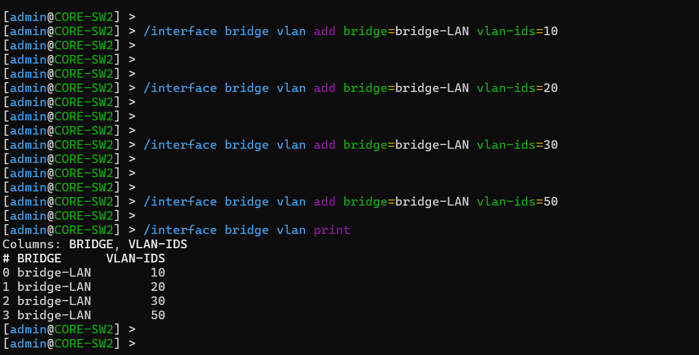
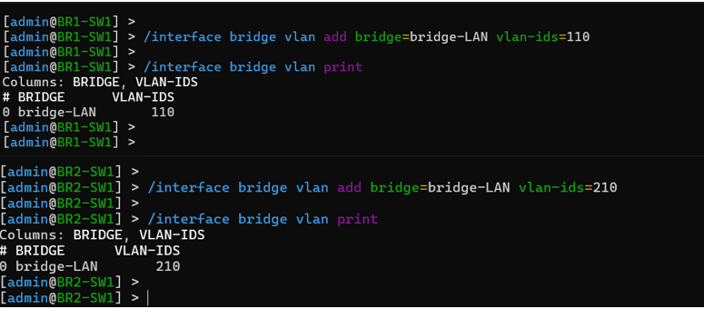
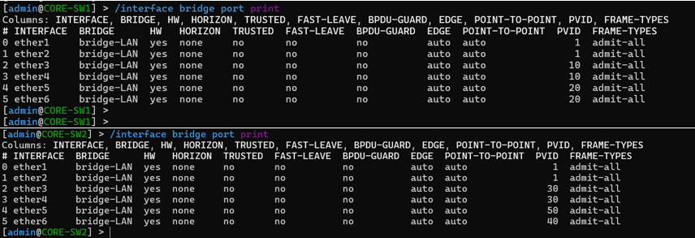
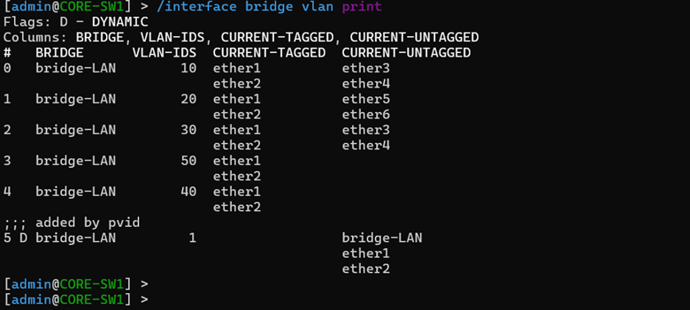
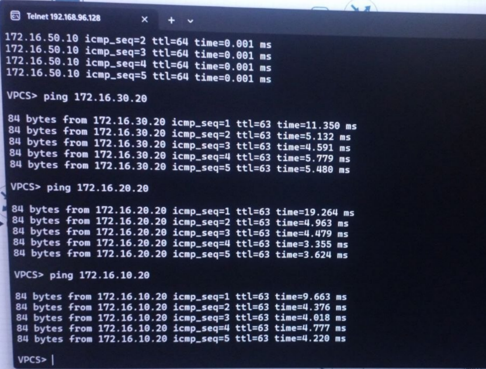

# 🚀 Phase 03 – Layer 2 Bridge VLAN & Trunk Configuration

> **Original EVE-NG implementation (tested):** The original EVE-NG lab was tested. [VLAN reachability](../images/testing/vlan-verification.png) and [inter-VLAN pings](../images/testing/inter-vlan-test.png) are recorded. The October source revision aligns access ports with the exported `.unl` cable map.
>
> **Source version note:** This detailed phase narrative preserves the original lab design, learning steps and screenshots. Some embedded CLI examples describe historical settings. For a clean import of the **October 2026 revised configuration**, use the matching [`configs/*.rsc` files](../configs/README.md), [network decisions](NETWORK-DECISIONS.md), and [rebuild checklist](REBUILD-AND-ACCEPTANCE.md); this revision has not been rerun in EVE-NG.

## 📌 Objective
The primary objective of this phase was to construct an industry-compliant Layer 2 architecture by implementing logical network segmentation using **IEEE 802.1Q Virtual Local Area Networks (VLANs)** across the entire enterprise fabric. This layout isolates corporate broadcast domains, mitigates unnecessary broadcast storms, optimizes traffic paths, and builds a strict trust barrier between functional zones before deploying higher-level routing layers.

---

## 🏗️ Enterprise VLAN Segmentation Matrix

The logical design groups corporate operations into independent, numbered broadcast groups. By matching the third octet of each network subnet directly to its structural VLAN ID, long-term administration and access control lists are highly streamlined.

### 1. Corporate Headquarters (HQ) Segment Allocations
The central campus switching core handles multiple local organizational segments, separating production, storage, and device management elements.

| VLAN ID | Broadcast Domain Name | Targeted Enterprise Department | Planning Objective & Logical Scope |
| :--- | :--- | :--- | :--- |
| **10** | `HR` | Human Resources | Isolates internal HR client systems and local employee records. |
| **20** | `SALES` | Sales Operations | Contains general sales transaction client endpoints and general traffic. |
| **30** | `IT` | IT Administration | Grants authorized secure access to systems administrators and engineering nodes. |
| **40** | `SERVER` | Central Core Datacenter | Encloses business infrastructure nodes including the File, Syslog, and NTP systems. |
| **50** | `MANAGEMENT` | Device Management Core | Anchors the physical out-of-band management interfaces for hardware nodes. |
| **60** | `PRINTER` | Network Printing Assets | Reserved explicitly for shared multi-function network printers. |

#### 📑 Documentation Evidence
##### Figure 1. Corporate Headquarters Active VLAN Mappings

*Active configuration table showing operational VLAN boundaries inside the core switching core.*

---

### 2. Distributed Branch Architecture Allocations
Remote branches leverage a dedicated numbering strategy, allocating the 100-series range for Branch-1 and the 200-series range for Branch-2 to avoid structural overlap.

#### Branch Office 1 Zone
| VLAN ID | Broadcast Domain Name | Target Function | Subnet Reference Placement |
| :--- | :--- | :--- | :--- |
| **110** | `BR1-USERS` | Local User Endpoints | Encloses local distributed client systems inside Branch-1. |
| **120** | `BR1-PRINTER` | Local Office Printers | Reserved for local physical output hardware resources. |

#### Branch Office 2 Zone
| VLAN ID | Broadcast Domain Name | Target Function | Subnet Reference Placement |
| :--- | :--- | :--- | :--- |
| **210** | `BR2-USERS` | Local User Endpoints | Encloses local distributed client systems inside Branch-2. |
| **220** | `BR2-PRINTER` | Local Office Printers | Reserved for branch multi-function hardware resources. |

#### 📑 Documentation Evidence
##### Figure 2. Branch Regional VLAN Assignments

*Logical metrics verifying isolation constraints deployed across remote branch edge switching nodes.*

---

## 🛠️ Access Port Ingress Filtering Configuration

To enforce strict edge validation, access switch interfaces are mapped directly to their targeted operational VLAN profiles. Using RouterOS v7 Bridge VLAN Filtering rules, untagged packets entering ingress ports are stamped with an explicit Port VLAN ID (PVID), safely separating traffic right at the network edge.

### Core Interface Membership Mapping Matrix:
* **CORE-SW1 Department Access Feeds:** `ether3` enforces a hard mapping to PVID 10 (HR). `ether4` binds traffic to PVID 20 (Sales). `ether5` dynamically tracks PVID 30 (IT Admin).
* **CORE-SW2 Data Center Access Feeds:** `ether3` maps directly to PVID 40 (Production Servers). `ether4` hosts administrative nodes on PVID 50 (Management). `ether7` isolates logging endpoints on PVID 40.
* **Remote Distributed Branch Feeds:** `BR1-SW1 ether2/ether3` binds local branch endpoints to PVID 110. `BR2-SW1 ether2` anchors remote nodes securely on PVID 210.

#### 📑 Documentation Evidence
##### Figure 3. Switch Interface Access Parameters

*Active configuration dashboard confirming successful PVID ingress mappings across local edge ports.*

---

## 🔀 Trunk Link Egress Tagging Implementation

To easily route multiple broadcast groups over a single physical cable, specific trunk links were established between core switches and gateway routers. These connections append standard 802.1Q headers to egress frames, preserving critical logical boundaries across the network.

### Production Implementation Logic (RouterOS v7 Standard):
1. **Switch-to-Router Uplinks:** `CORE-SW1 ether1` bridges to `HQ-R1`. `CORE-SW2 ether1` mirrors this uplink to `HQ-R2`. Both configurations allow tagged egress tracking for the entire corporate profile.
2. **Inter-Switch Fabric Backbone:** `CORE-SW1 ether2 ↔ CORE-SW2 ether2` forms a vital cross-chassis backbone. This link tags traffic across all enterprise zones, allowing smooth transit between corporate switches.
3. **Branch Boundary Feeds:** `BR1-SW1 ether1` and `BR2-SW1 ether1` tag local traffic up to their respective branch gateway interfaces.

```text
  [ Untagged Frame ] ──> Ingress Access Port (Stamps PVID tag onto packet header)
                                    │
                                    ▼
  [ Tagged 802.1Q Frame ] ──> Transport Trunk Link (Preserves logical zone separation)
                                    │
                                    ▼
  [ Filtered Output ] ──> Egress Bridge Filtering Engine (Drops mismatched tags instantly)
```

#### 📑 Documentation Evidence
##### Figure 4. 802.1Q Trunk Pipeline Verification

*Terminal parameters displaying established 802.1Q trunk lines bridging multi-vlan traffic.*

---

## 🔍 Layer 2 Structural Verification

Once configuration scripts were applied, the local switch bridge databases were audited using `/interface/bridge/vlan/print` to confirm absolute stability:
* Confirmed that VLAN identification headers accurately matched their intended structural locations.
* Verified that ingress access ports correctly handled PVID tracking, stripping outbound tags seamlessly on egress.
* Audited all inter-switch core lines to confirm they were stably processing 802.1Q tagged headers.
* Activated hardware-level bridge filtering (`vlan-filtering=yes`) across all devices to lock down and protect the Layer 2 boundaries.

#### 📑 Documentation Evidence
##### Figure 5. Bridge VLAN Database Audit

*Live terminal verification showing a clean, error-free Layer 2 database alignment.*

---

## 🔍 Validation Matrix

| Target Verification Control Item | Current Status | Technical Metrics / Observations |
| :--- | :--- | :--- |
| **HQ Segment Matrices Instantiated** | ✅ Validated | Database accurately maps corporate zones 10, 20, 30, 40, and 50. |
| **Branch Distribution Layers Built** | ✅ Validated | Branch-1 (110) and Branch-2 (210) domains verified active. |
| **Ingress Access Ports Mapped** | ✅ Validated | Edge ports correctly drop untagged frames into designated PVID zones. |
| **802.1Q Core Trunk Fabrics Fixed** | ✅ Validated | Inter-switch and router pipelines actively tagging egress headers. |
| **Bridge VLAN Filtering Activated** | ✅ Validated | Dynamic hardware filtering active; illegal frames dropped at edge. |
| **Layer 2 Broadcast Domains Isolated** | ✅ Verified | Inter-switch leaks prevented; environment prepped for L3 routing. |

---

## 🎯 Phase Outcome
Phase 03 has successfully met its structural design criteria. The raw physical network topology is now neatly partitioned into isolated, hardware-enforced Layer 2 broadcast domains. Ingress filtering actively controls edge traffic, core trunk links successfully tag data across the fabric, and unmapped packets are immediately blocked. The corporate environment has passed all Layer 2 stability checks and is fully ready for Phase 04, where we will establish Inter-VLAN Routing using a high-availability Router-on-a-Stick gateway configuration.

---

## October 2026 — Updated configuration reference

The current Layer-2 source is the four `configs/*SW1.rsc` files. These bridge scripts use tagged trunks, explicit PVIDs and `ingress-filtering=yes` with suitable `frame-types`. Each switch starts with `vlan-filtering=no`, programs its ports and VLAN table, then enables filtering.

## EVE-NG access-port map

| Switch | Access ports | VLAN |
| --- | --- | --- |
| CORE-SW1 | ether3/ether4: HR-PC1/HR-PC2 | 10 |
| CORE-SW1 | ether5/ether6: SALES-PC1/SALES-PC2 | 20 |
| CORE-SW2 | ether3/ether4: IT-PC1/IT-PC2 | 30 |
| CORE-SW2 | ether5: ADMIN-PC | 50 |
| CORE-SW2 | ether6/ether7: File and Syslog placeholders | 40 |
| BR1-SW1 | ether2/ether3: branch clients | 110 |
| BR2-SW1 | ether2/ether3: branch clients | 210 |

Trunk mapping: each core switch `ether1` faces its HQ router and `ether2` faces the other core switch. Branch `ether1` faces the router.

VLAN 60, 120 and 220 are reserved in the plan but **not present in this build**.

## Check after importing

```routeros
/interface bridge port print detail
/interface bridge vlan print
/interface bridge host print
```

The original port mapping was inconsistent with the actual `.unl` endpoint cables (notably Sales/IT and the second Branch-2 client). The revised scripts use the exported wiring. This correction is statically checked but has not been boot-tested.

Historical screenshots are under `images/phase-03/`; do not reuse them as acceptance evidence for this revision.
