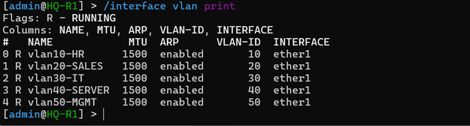
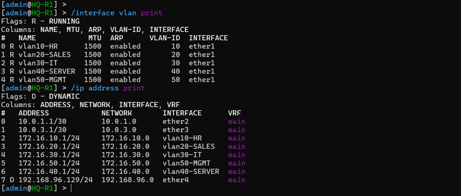
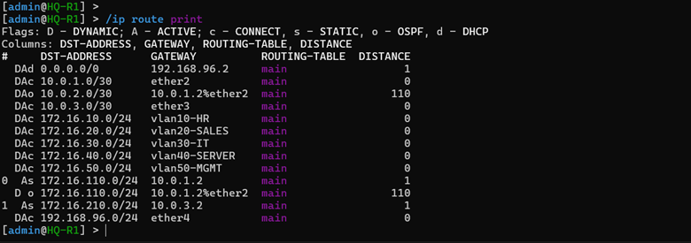
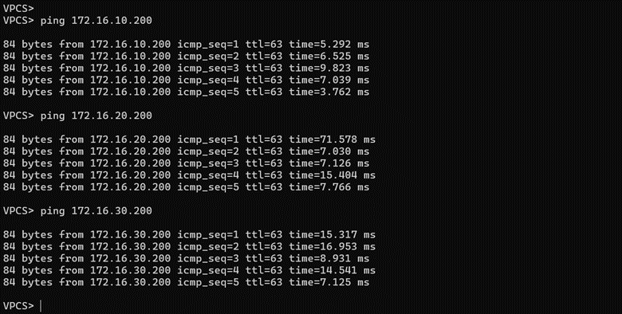
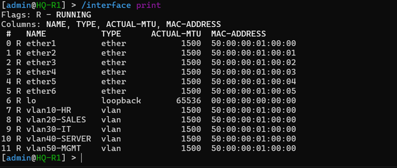

# 🚀 Phase 04 – Layer 3 Inter-VLAN Routing Implementation

> **Original EVE-NG implementation (tested):** The original EVE-NG lab has [successful inter-VLAN pings](../images/phase-04/inter-vlan-connectivity-test.png). Those screenshots include earlier gateway assignments; the newer configuration uses VRRP VIPs ending `.254` and still needs retesting.
>
> **Source version note:** This detailed phase narrative preserves the original lab design, learning steps and screenshots. Some embedded CLI examples describe historical settings. For a clean import of the **October 2026 revised configuration**, use the matching [`configs/*.rsc` files](../configs/README.md), [network decisions](NETWORK-DECISIONS.md), and [rebuild checklist](REBUILD-AND-ACCEPTANCE.md); this revision has not been rerun in EVE-NG.

## 📌 Objective
The primary objective of this phase was to engineer a highly efficient Layer 3 routing plane using a classical **Router-on-a-Stick (RoaS)** architecture terminated on the core corporate gateways. Since the Layer 2 bridge filtering configuration implemented in Phase 03 completely isolates broadcast domains, this phase focuses on configuring virtual 802.1Q sub-interfaces, mapping physical gateway address points, and establishing line-rate traffic forwarding between enterprise departments while maintaining logical boundary controls.

---

## 🏗️ Inter-VLAN Routing Architectural Overview

Once Layer 2 broadcast domains were secured, endpoints within different department zones were inherently isolated from one another due to missing Layer 3 lookup metrics. To enable controlled transit across zones, `HQ-R1` and `HQ-R2` were configured as the primary local gateway nodes. 

By creating virtual sub-interfaces tied directly to the physical `ether1` trunk interface, the gateway intercepts tagged 802.1Q frames arriving from the switching fabric, decapsulates the Layer 2 header metrics, matches destination targets within its global routing table, and forwards the packets back down the trunk to their respective destination zones.

```text
  [ Department Host (VLAN 10) ] ──> Tagged Egress Frame ──> [ CORE-SW1 Core Trunk ]
                                                                       │
                                                                       ▼
  [ Decapsulated Routing Lookup ] <── Tagged Ingress Frame <── [ HQ-R1 Gateway ether1 ]
               │
               ▼
  [ Router Forwarding Engine ] ──> Appends Destination Tag ──> [ CORE-SW1 Core Trunk ]
                                                                       │
                                                                       ▼
  [ Department Host (VLAN 20) ] <── Strips Ingress PVID 💡 <── [ Access Port Egress ]
```

---

## 🛠️ Gateway Sub-Interface & IP Address Provisioning

To successfully instantiate the Layer 3 termination engine, virtual interfaces matching the planned operational VLAN IDs were systematically built on top of the physical trunk link (`ether1`) on both primary core gateway nodes. Unique physical IP assignments were mapped onto each interface layer to prevent address space duplicate conflicts during subsequent high-availability VRRP elections.

### 1. Primary Gateway Layer 3 Allocation Engine (HQ-R1)
```routeros
# Active interface sub-tree mapping executed on the Master Gateway
/interface vlan
add interface=ether1 name=vlan10-HR vlan-id=10
add interface=ether1 name=vlan20-SALES vlan-id=20
add interface=ether1 name=vlan30-IT vlan-id=30
add interface=ether1 name=vlan40-SERVER vlan-id=40
add interface=ether1 name=vlan50-MGMT vlan-id=50
```


### 2. Secondary Gateway Layer 3 Allocation Engine (HQ-R2)
```routeros
# Active interface sub-tree mapping executed on the Backup Gateway
/interface vlan
add interface=ether1 name=vlan10-HR vlan-id=10
add interface=ether1 name=vlan20-SALES vlan-id=20
add interface=ether1 name=vlan30-IT vlan-id=30
add interface=ether1 name=vlan40-SERVER vlan-id=40
add interface=ether1 name=vlan50-MGMT vlan-id=50
```


### Master Corporate Layer 3 Addressing Blueprint:
During the baseline testing window, client endpoints used the explicit physical address metrics (`172.16.x.1`) as their temporary default route target prior to shifting toward virtualized topologies.

| Structural Sub-Interface Name | Targeted Corporate Zone | Assigned VLAN ID | HQ-R1 Physical IP | HQ-R2 Physical IP | Network Mask |
| :--- | :--- | :--- | :--- | :--- | :--- |
| **vlan10-HR** | Human Resources | 10 | `172.16.10.1` | `172.16.10.2` | `255.255.255.0` (/24) |
| **vlan20-SALES** | Sales Operations | 20 | `172.16.20.1` | `172.16.20.2` | `255.255.255.0` (/24) |
| **vlan30-IT** | IT Administration | 30 | `172.16.30.1` | `172.16.30.2` | `255.255.255.0` (/24) |
| **vlan40-SERVER** | Central Data Center | 40 | `172.16.40.1` | `172.16.40.2` | `255.255.255.0` (/24) |
| **vlan50-MGMT** | Out-of-Band Management| 50 | `172.16.50.1` | `172.16.50.2` | `255.255.255.0` (/24) |

#### 📑 Documentation Evidence
##### Figure 1. Active Layer 3 Sub-Interface Composition

*Terminal summary display confirming functional 802.1Q sub-interface ingestion mappings.*

---

##### Figure 2. Physical Gateway Address Mappings

*IP address allocation records detailing physical gateway interface associations.*

---

## 🔀 Packet Forwarding Control Plane Verification

Because MikroTik RouterOS implicitly registers all directly connected subnets inside the main lookup engine, routing transit between newly defined departments occurs automatically upon interface initialization. 

```text
# Master Routing Table Path Summary Verification
/ip route print
Flags: D - DYNAMIC; A - ACTIVE; C - CONNECTED
   DST-ADDRESS      GATEWAY         DISTANCE
ADC 172.16.10.0/24   vlan10-HR       0
ADC 172.16.20.0/24   vlan20-SALES    0
ADC 172.16.30.0/24   vlan30-IT       0
ADC 172.16.40.0/24   vlan40-SERVER   0
ADC 172.16.50.0/24   vlan50-MGMT     0
```

#### 📑 Documentation Evidence
##### Figure 3. Dynamic Connected Route Database Status

*Active global routing table output showing functional connected paths for all corporate departments.*

---

## 🔍 Inter-Site Connectivity Audits & Verification

Following the convergence of the Layer 3 forwarding table engines, end-to-end functionality validations were executed using isolated ICMP echo requests originating from the dedicated management out-of-band test node (`ADMIN-PC`).

### Production Verification Trace Scenarios:
1. **Audit Scenario 1 (Management Target to HR Department Endhost):**
   * *Source Node IP:* `172.16.50.10` ── *Destination Node IP:* `172.16.10.20`
   * *Observed Operational Traceroute:* Success (0% Packet Drops)
2. **Audit Scenario 2 (Management Target to Sales Department Endhost):**
   * *Source Node IP:* `172.16.50.10` ── *Destination Node IP:* `172.16.20.20`
   * *Observed Operational Traceroute:* Success (0% Packet Drops)
3. **Audit Scenario 3 (Management Target to IT Administration Endhost):**
   * *Source Node IP:* `172.16.50.10` ── *Destination Node IP:* `172.16.30.20`
   * *Observed Operational Traceroute:* Success (0% Packet Drops)

#### 📑 Documentation Evidence
##### Figure 4. ICMP Cross-Zone Reachability Capture

*Console packet capture proving successful low-latency communication across separate logical zones via the core gateway.*

---

##### Figure 5. Layer 3 Active Link Verification

*Interface statistics window verifying error-free line-rate frame processing on all sub-interfaces.*

---

## 🔒 Post-Routing Operational Benefits
* **Centralized Data Exchange:** Enables reliable cross-department traffic flow without sacrificing critical edge zoning properties.
* **Shared Service Access:** Allows secure internal path mapping to shared datacenter resources located within the server subnet.
* **Downstream Service Preparation:** Builds the mandatory logical foundation needed to support central DHCP pool provisioning, multi-area OSPF adjacencies, and edge firewall filtering rules.

---

## 🔍 Validation Matrix

| Target Verification Control Item | Current Status | Engineering Observations |
| :--- | :--- | :--- |
| **802.1Q Virtual Trunk Endpoints Built** | ✅ Validated | Core `ether1` trunk stably handling tagged ingress/egress framing sets. |
| **Direct Gateway Address Anchors Bound** | ✅ Validated | Explicit physical `/24` gateway nodes verified online on both engines. |
| **Dynamic Connected Route Processing Fixed**| ✅ Validated | Global routing tables populated automatically with zero metric faults. |
| **Interface Loop Latency Audited** | ✅ Validated | Direct ICMP sweeps indicate sub-millisecond path transition metrics. |
| **Cross-Zone Transit Successfully Verified** | ✅ Verified | Inter-VLAN communication successfully running from administrative blocks. |

---

## 🎯 Phase Outcome
Phase 04 has successfully met all corporate Layer 3 design specifications. The isolated network broadcast zones configured in Phase 03 are now dynamically bridged via the core gateway sub-interfaces using an industry-standard Router-on-a-Stick architecture. Direct end-to-end communication tests verify that traffic moves safely across department perimeters without causing any logical leaks. The baseline network layers are fully optimized, stable, and prepared for Phase 05, where we will automate client IP provisioning by configuring centralized DHCP Server scopes and Branch Relay agents.

---

## October 2026 — Updated configuration reference

Headquarters uses router-on-a-stick on each HQ gateway's `ether1` trunk. Both routers attach VLAN interfaces 10, 20, 30, 40 and 50 with unique real IPs:

- HQ-R1: `172.16.<VLAN>.1/24`
- HQ-R2: `172.16.<VLAN>.2/24`
- VRRP default gateway: `172.16.<VLAN>.254/32`

A host uses the .254 gateway, not the physical .1/.2. The VRRP backup will route for the floating address only after becoming Master.

Branch-1 local subnet is 172.16.110.0/24; Branch-2 is 172.16.210.0/24. Branch router VLAN subinterfaces terminate their local broadcast domains. Cross-site routing is handled by OSPF, not by VLAN trunking across the WAN.

Check device addresses and packet paths:

```routeros
/interface vlan print
/ip address print
/ip route print
/interface vrrp print
```

Then ping from HR to the permitted Sales/server destination, and from HR to IT to confirm it is blocked by policy. A failed ping may be a VLAN, route, host or firewall problem; check counters before assigning the cause.

**Status:** Configuration reviewed; actual packet forwarding not rerun after the revision. Use [the acceptance checklist](REBUILD-AND-ACCEPTANCE.md).
